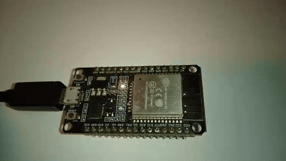

# Tharsis

**C en español para ESP32.**

Tharsis es un transpilador que te permite escribir C con palabras clave en español (`entero`, `si`, `mientras`, `imprimir`...) y compilarlo con el mismo toolchain de ESP-IDF que ya usas. El `.c` generado es legible, editable, y compila con `idf.py` sin cambios.

**No es un lenguaje nuevo.** Es C con keywords en español. Todo lo que sabes de C y ESP-IDF sigue aplicando.

## Estado

**v0.3.0** — Blinky funcional en ESP32-WROOM-32 real.

- ✅ Transpilador host con 12 golden tests verdes.
- ✅ Modo `--modo idf` para ESP-IDF.
- ✅ Ejemplo Blinky compilando y flasheando en hardware real.

## Por qué

La mayoría de documentación, tutoriales y ejemplos de ESP32 están en inglés. Para quien aprende embebidos en español, eso es una barrera extra. Tharsis no inventa un lenguaje nuevo: pone las palabras clave en español para que el primer contacto con C y ESP-IDF sea más fácil. El `.c` generado es C estándar, así que lo aprendido sirve igual.

## Instalación

Requisitos:

- `g++` (C++17) y `gcc` (C17).
- Para ESP32: ESP-IDF v5.x instalado y configurado (`idf.py` en el PATH).

En Debian/Ubuntu:

    sudo apt install g++ build-essential

En Arch/Manjaro:

    sudo pacman -S gcc

Clonar y compilar:

    git clone https://github.com/AlphonsusRex/Tharsis.git
    cd Tharsis
    g++ -std=c++17 -O2 tharsis_gen.cpp -o tharsis_gen

## Uso en host (PC)

`hola.t`:

    principal() {
        imprimir("Hola desde Tharsis\n");
        retornar 0;
    }

    ./tharsis_gen hola.t --solo-c   # solo genera hola.c
    ./tharsis_gen hola.t            # genera y compila con gcc
    ./hola
    # Hola desde Tharsis

## Uso en ESP32 (Blinky)

El ejemplo completo está en `examples/esp32/blinky/`.

`examples/esp32/blinky/main/blinky.t`:

*LED del GPIO 2 parpadeando cada 500 ms en una ESP32-WROOM-32 real.*
    
    #include "driver/gpio.h"

    #define LED_GPIO 2

    principal() {
        gpio_config_t config_led = {
            .pin_bit_mask = (1ULL << LED_GPIO),
            .mode = GPIO_MODE_OUTPUT,
            .pull_up_en = GPIO_PULLUP_DISABLE,
            .pull_down_en = GPIO_PULLDOWN_DISABLE,
            .intr_type = GPIO_INTR_DISABLE
        };
        gpio_config(&config_led);

        mientras (verdadero) {
            gpio_set_level(LED_GPIO, 1);
            retardo(500);
            gpio_set_level(LED_GPIO, 0);
            retardo(500);
        }
    }

Compilar y flashear:

    cd examples/esp32/blinky
    . $HOME/esp/esp-idf/export.sh    # o donde tengas ESP-IDF
    ../../../../tharsis_gen main/blinky.t --modo idf --solo-c
    idf.py set-target esp32
    idf.py build
    idf.py -p /dev/ttyUSB0 flash monitor

El LED del GPIO 2 (normalmente el LED azul integrado) parpadea cada 500 ms.

**Verificado en**: ESP32-WROOM-32 (ESP32-D0WDQ6 rev 1.0).

## Uso en ESP32 (ADC)

Lee un potenciómetro en el GPIO 34 y muestra el valor por el monitor serie.

`examples/esp32/adc/main/adc.t`:

    #include "driver/adc.h"
    
    #define CANAL_ADC ADC1_CHANNEL_6   // GPIO 34
    
    vacio tarea_lectura(vacio *arg) {
        mientras (verdadero) {
            entero valor = adc1_get_raw(CANAL_ADC);
            LOG_INFO("Valor ADC: %d", valor);
            retardo_ms(500);
        }
    }
    
    principal() {
        adc1_config_width(ADC_WIDTH_BIT_12);
        adc1_config_channel_atten(CANAL_ADC, ADC_ATTEN_DB_11);
        LOG_INFO("ADC inicializado en GPIO 34");
        tarea(tarea_lectura, "tarea_adc");
        mientras (verdadero) {
            retardo_ms(1000);
        }
    }

Compilar y flashear:

    cd examples/esp32/adc
    ../../../../tharsis_gen main/adc.t --modo idf --solo-c
    idf.py build
    idf.py -p /dev/ttyUSB0 flash monitor

## Referencia Tharsis ↔ C

Esta tabla es el contrato del lenguaje. Cualquier cambio aquí es un cambio de versión.

### Tipos

| Tharsis | C |
|---|---|
| `entero` | `int` |
| `decimal` | `float` |
| `doble` | `double` |
| `caracter` | `char` |
| `booleano` | `bool` |
| `vacio` | `void` |
| `largo` | `long` |
| `corto` | `short` |

### Modificadores

| Tharsis | C |
|---|---|
| `constante` | `const` |
| `estatico` | `static` |
| `sin_signo` | `unsigned` |
| `con_signo` | `signed` |
| `estructura` | `struct` |
| `definir_tipo` | `typedef` |
| `enumeracion` | `enum` |

### Control de flujo

| Tharsis | C |
|---|---|
| `si` | `if` |
| `sino` | `else` |
| `mientras` | `while` |
| `para` | `for` |
| `hacer` | `do` |
| `segun` | `switch` |
| `caso` | `case` |
| `por_defecto` | `default` |
| `retornar` | `return` |
| `romper` | `break` |
| `continuar` | `continue` |

### Operadores lógicos

| Tharsis | C |
|---|---|
| `Y` | `&&` |
| `O` | `\|\|` |
| `NO` | `!` |

Los operadores se reconocen por palabra completa. `nota` y `yacimiento` no se ven afectados.

### Booleanos y utilidades

| Tharsis | C |
|---|---|
| `verdadero` | `true` |
| `falso` | `false` |
| `imprimir` | `printf` (host) / `ESP_LOGI(TAG, ...)` (idf) |
| `talla_de` | `sizeof` |
| `nulo` | `NULL` |
| `tomar_cadena(buf, tam)` | `fgets(buf, tam, stdin)` (solo host) |
| `retardo(ms)` | `vTaskDelay(pdMS_TO_TICKS(ms))` (solo idf) |
| `principal` | `main` (host) / `app_main` (idf) |

### Azúcar ESP-IDF (solo modo idf)

| Tharsis | C (ESP-IDF) |
|---|---|
| `LOG_INFO(...)` | `ESP_LOGI(TAG, ...)` |
| `LOG_AVISO(...)` | `ESP_LOGW(TAG, ...)` |
| `LOG_ERROR(...)` | `ESP_LOGE(TAG, ...)` |
| `retardo_ms(ms)` | `vTaskDelay(pdMS_TO_TICKS(ms))` |
| `tarea(func, nombre)` | `xTaskCreate(func, nombre, 2048, NULL, 5, NULL)` |

## Cómo funciona

1. Lee un archivo `.t` línea a línea.
2. Distingue strings, chars, comentarios y código.
3. Sustituye las palabras del diccionario por su equivalente C.
4. Emite un `.c` con cabeceras estándar (o de IDF si `--modo idf`).

Los strings, chars y comentarios no se traducen. Las directivas `#include`, `#define`, etc. pasan tal cual. En modo idf, se añaden cabeceras de FreeRTOS y `esp_log.h`, y `principal` se convierte en `app_main`.

## Tests

    bash test/run_tests.sh
    # PASS: 12  FAIL: 0

Cada test es un `.t` + un `.c.esperado`. Si el `.c` generado difiere del esperado, el test falla. Esto garantiza que ningún cambio rompa el comportamiento existente.

## Limitaciones conocidas (v0.3.0)

- **No es un lenguaje completo**: es C con keywords en español. La sintaxis debe ser C válido.
- **`imprimir(x)` sin formato no funciona**: usa `imprimir("%d\n", x)` en host.
- **Sin `leer`**: pendiente (necesita tipos).
- **`retardo` solo en idf**: no existe en host.
- **Sustitución de tokens, no parser**: si escribes C inválido, genera C inválido.
- **`TAG` se emite siempre en idf**: aunque no uses `imprimir`, gcc dará un warning de "defined but not used".

## Roadmap

- **v0.3.0** ✅ — Modo idf + Blinky en ESP32 real.
- **v0.4.0** — Azúcar ESP-IDF: `tarea`, `log_info`, `externo "..."`, `seccion_critica`.
- **v0.5.0** — Wrapper `tharsis build/flash/monitor`.
- **v0.6.0** — Parser ligero para `imprimir` con formato automático.
- **v1.0.0** — Release estable con ejemplos completos y docs.

## Contribuir

Issues y pull requests son bienvenidos. Para cambios en el diccionario o el lexer:

1. Añade un golden test en `test/golden/`.
2. Verifica que `bash test/run_tests.sh` sigue en verde.
3. Actualiza la tabla de referencia en este README.
4. Commit con mensaje `feat:`, `fix:` o `docs:`.

## Licencia

MIT.
